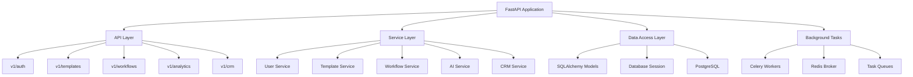
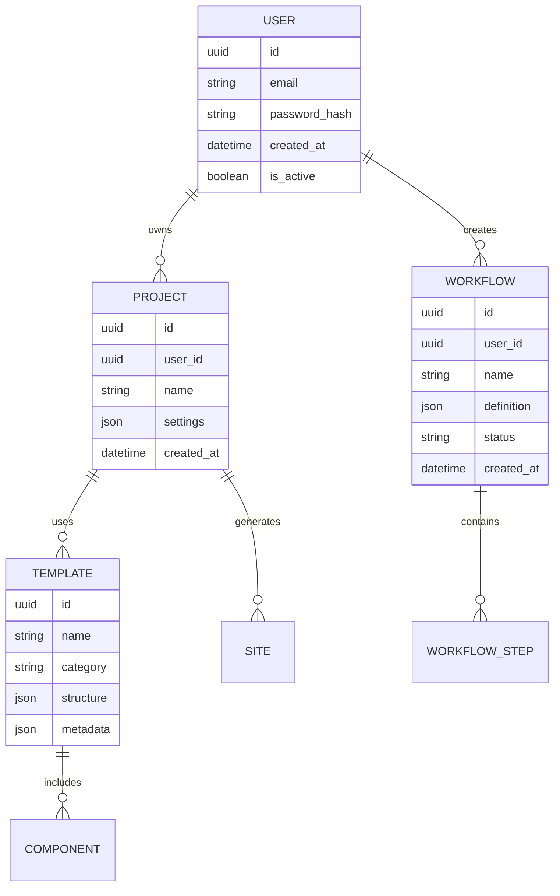
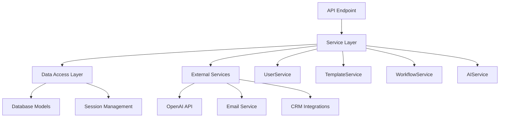
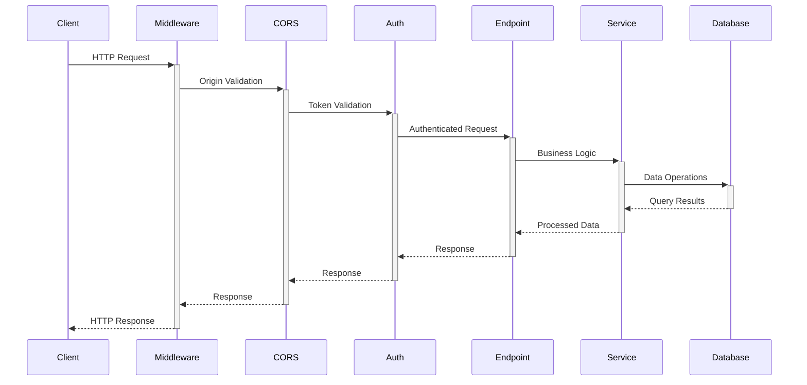
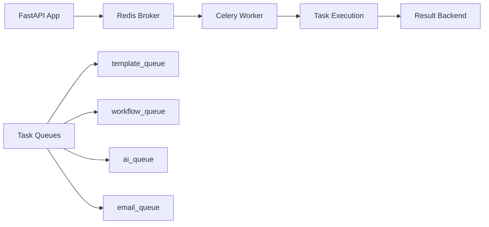

# Backend Server Design

## Overview

The AI Marketing Web Builder backend is a FastAPI-based Python application that serves as the core API layer for the marketing automation platform. The server provides RESTful endpoints for user authentication, template management, workflow automation, CRM integration, and AI-powered features. Built with modern async Python practices, the backend supports real-time collaboration, background task processing, and seamless integration with external AI services.

## Architecture

### Technology Stack

| Component | Technology | Purpose |
|-----------|------------|---------|
| **Web Framework** | FastAPI | High-performance async API framework |
| **Python Version** | 3.11+ | Runtime environment |
| **Database** | PostgreSQL + SQLAlchemy | Relational data storage with async ORM |
| **Cache/Queue** | Redis | Caching, session storage, task queue |
| **Task Processing** | Celery | Background job execution |
| **Web Server** | Uvicorn | ASGI application server |
| **Security** | OAuth2 + JWT | Authentication and authorization |

### Application Structure



### Directory Structure

```
backend/
├── app/
│   ├── api/
│   │   ├── v1/
│   │   │   ├── endpoints/       # API route handlers
│   │   │   └── api.py           # Router aggregation
│   │   └── deps.py              # Dependency injection
│   ├── core/
│   │   ├── config.py            # Application settings
│   │   ├── database.py          # Database configuration
│   │   ├── security.py          # Authentication/security
│   │   └── celery.py            # Background task config
│   ├── models/                  # SQLAlchemy data models
│   ├── schemas/                 # Pydantic request/response models
│   ├── services/                # Business logic layer
│   ├── tasks/                   # Celery task definitions
│   ├── utils/                   # Utility functions
│   └── main.py                  # FastAPI application entry
├── tests/                       # Test suite
├── alembic/                     # Database migrations
├── requirements.txt             # Python dependencies
├── docker-compose.yml           # Multi-service orchestration
├── Dockerfile                   # Container definition
└── run.py                       # Development server runner
```

## Server Startup Procedures

### Development Environment Setup

#### Prerequisites Verification
```bash
# Check Python version (3.11+ required)
python --version

# Check if PostgreSQL is installed
pg_config --version

# Check if Redis is available
redis-cli ping
```

#### Environment Preparation
```bash
# Navigate to backend directory
cd backend

# Create and activate virtual environment
python -m venv venv
source venv/bin/activate  # Linux/macOS
# OR
venv\Scripts\activate     # Windows

# Install dependencies
pip install -r requirements.txt

# Set up environment variables
cp .env.example .env
# Edit .env with your configuration
```

#### Database Initialization
```bash
# Run database migrations
alembic upgrade head

# Verify database connection
python test_env.py
```

### Server Startup Methods

#### Method 1: Direct Python Execution
```bash
# Start using run.py
python run.py

# Or start using main.py
python -m app.main

# Or using uvicorn directly
uvicorn app.main:app --reload --host 0.0.0.0 --port 8000
```

#### Method 2: Automated Development Scripts
```bash
# Cross-platform startup (recommended)
./dev-start.sh          # Linux/macOS
dev-start.bat           # Windows CMD
./dev-start.ps1         # Windows PowerShell
```

#### Method 3: Docker Compose (Full Stack)
```bash
# Start all services (PostgreSQL, Redis, API, Celery)
docker-compose up -d

# View logs
docker-compose logs -f backend

# Stop services
docker-compose down
```

### Service Verification

#### Health Check Validation
```bash
# Test basic connectivity
curl http://localhost:8000/health

# Expected response:
{
  "status": "healthy",
  "version": "1.0.0",
  "environment": "development"
}
```

#### API Documentation Access
- **Swagger UI**: http://localhost:8000/docs
- **ReDoc**: http://localhost:8000/redoc
- **OpenAPI JSON**: http://localhost:8000/api/v1/openapi.json

#### Database Connection Test
```bash
# Run database connectivity test
python test_basic.py

# Check migration status
alembic current
alembic history
```

## Configuration Management

### Environment Variables

| Variable | Default | Description |
|----------|---------|-------------|
| `DATABASE_URL` | postgresql+asyncpg://... | PostgreSQL connection string |
| `REDIS_URL` | redis://localhost:6379/0 | Redis connection URL |
| `SECRET_KEY` | dev-secret-key | JWT signing secret |
| `DEBUG` | true | Enable debug mode and docs |
| `ENVIRONMENT` | development | Deployment environment |
| `ALLOWED_ORIGINS` | ["http://localhost:3003"] | CORS allowed origins |
| `DB_POOL_SIZE` | 5 | Database connection pool size |
| `ACCESS_TOKEN_EXPIRE_MINUTES` | 30 | JWT token expiration |

### Application Settings
```python
# app/core/config.py - Configuration structure
class Settings(BaseSettings):
    APP_NAME: str = "AI Marketing Web Builder API"
    VERSION: str = "1.0.0"
    DESCRIPTION: str = "Backend API for AI-powered marketing website builder"
    
    # Database
    DATABASE_URL: str
    DB_POOL_SIZE: int = 5
    DB_MAX_OVERFLOW: int = 10
    
    # Security
    SECRET_KEY: str
    ACCESS_TOKEN_EXPIRE_MINUTES: int = 30
    
    # Environment
    DEBUG: bool = True
    ENVIRONMENT: str = "development"
    ALLOWED_ORIGINS: List[str] = ["http://localhost:3003"]
```

## API Endpoints Reference

### Core API Structure
```mermaid
graph LR
    A[/api/v1] --> B[/auth]
    A --> C[/templates]
    A --> D[/workflows]
    A --> E[/analytics]
    A --> F[/crm]
    A --> G[/ai-features]
    
    B --> B1[POST /login]
    B --> B2[POST /register]
    B --> B3[POST /refresh]
    B --> B4[POST /logout]
    
    C --> C1[GET /templates]
    C --> C2[POST /templates]
    C --> C3[PUT /templates/{id}]
    C --> C4[DELETE /templates/{id}]
    
    D --> D1[GET /workflows]
    D --> D2[POST /workflows]
    D --> D3[POST /workflows/execute]
    D --> D4[WebSocket /workflows/debug]
```

### Authentication Endpoints
- `POST /api/v1/auth/login` - User authentication
- `POST /api/v1/auth/register` - User registration
- `POST /api/v1/auth/refresh` - Token refresh
- `POST /api/v1/auth/logout` - User logout

### Business Logic Endpoints
- `GET /api/v1/templates` - List available templates
- `POST /api/v1/workflows` - Create workflow automation
- `GET /api/v1/analytics/performance` - Performance metrics
- `POST /api/v1/ai-features/suggest` - AI component suggestions

## Data Models & ORM Mapping

### Core Models Architecture


### Model Definitions
```python
# Base model with common fields
class BaseModel(Base):
    id: Mapped[UUID] = mapped_column(UUID(as_uuid=True), primary_key=True, default=uuid4)
    created_at: Mapped[datetime] = mapped_column(DateTime, default=func.now())
    updated_at: Mapped[datetime] = mapped_column(DateTime, default=func.now(), onupdate=func.now())

# User model for authentication
class User(BaseModel):
    __tablename__ = "users"
    
    email: Mapped[str] = mapped_column(String, unique=True, index=True)
    password_hash: Mapped[str] = mapped_column(String)
    is_active: Mapped[bool] = mapped_column(Boolean, default=True)
    
    # Relationships
    projects: Mapped[List["Project"]] = relationship("Project", back_populates="user")
    workflows: Mapped[List["Workflow"]] = relationship("Workflow", back_populates="user")
```

## Business Logic Layer

### Service Architecture Pattern


### Base Service Implementation
```python
# app/services/base_service.py
class BaseService:
    def __init__(self, db: AsyncSession):
        self.db = db
    
    async def create(self, obj_in: CreateSchemaType) -> ModelType:
        obj_data = obj_in.model_dump()
        db_obj = self.model(**obj_data)
        self.db.add(db_obj)
        await self.db.commit()
        await self.db.refresh(db_obj)
        return db_obj
    
    async def get(self, id: UUID) -> Optional[ModelType]:
        result = await self.db.execute(select(self.model).where(self.model.id == id))
        return result.scalar_one_or_none()
    
    async def update(self, id: UUID, obj_in: UpdateSchemaType) -> Optional[ModelType]:
        db_obj = await self.get(id)
        if db_obj:
            obj_data = obj_in.model_dump(exclude_unset=True)
            for field, value in obj_data.items():
                setattr(db_obj, field, value)
            await self.db.commit()
            await self.db.refresh(db_obj)
        return db_obj
```

## Middleware & Interceptors

### Security Middleware
- **CORS Middleware**: Cross-origin request handling for frontend integration
- **Trusted Host Middleware**: Host validation in production environments
- **Authentication Middleware**: JWT token validation and user context

### Request Processing Pipeline


### Exception Handling
```python
# Global exception handlers
@app.exception_handler(HTTPException)
async def http_exception_handler(request: Request, exc: HTTPException):
    return JSONResponse(
        status_code=exc.status_code,
        content={
            "error": True,
            "message": exc.detail,
            "status_code": exc.status_code
        }
    )

@app.exception_handler(ValidationError)
async def validation_exception_handler(request: Request, exc: ValidationError):
    return JSONResponse(
        status_code=422,
        content={
            "error": True,
            "message": "Validation error",
            "details": exc.errors()
        }
    )
```

## Background Task Processing

### Celery Configuration


### Task Categories
- **Template Processing**: Template optimization and generation
- **Workflow Execution**: Automated workflow processing
- **AI Operations**: Component suggestions and optimizations
- **Email Campaigns**: Automated email sending and tracking
- **Analytics**: Performance data collection and analysis

### Task Definition Example
```python
# app/tasks/template.py
from celery import Celery
from app.core.celery import celery_app

@celery_app.task(bind=True, queue='template')
def optimize_template(self, template_id: str, optimization_params: dict):
    """Optimize template performance and structure."""
    try:
        # Template optimization logic
        result = perform_template_optimization(template_id, optimization_params)
        return {"status": "success", "result": result}
    except Exception as exc:
        self.retry(countdown=60, max_retries=3)
        raise exc
```

## Testing Strategy

### Test Structure
```
tests/
├── unit/                    # Unit tests for individual components
│   ├── test_services/       # Service layer tests
│   ├── test_models/         # Model validation tests
│   └── test_utils/          # Utility function tests
├── integration/             # Integration tests
│   ├── test_api/            # API endpoint tests
│   ├── test_database/       # Database operation tests
│   └── test_auth/           # Authentication flow tests
└── conftest.py              # Test configuration and fixtures
```

### Test Execution
```bash
# Run all tests
pytest

# Run with coverage
pytest --cov=app --cov-report=html

# Run specific test categories
pytest tests/unit/
pytest tests/integration/

# Run tests with verbose output
pytest -v -s
```

### Database Testing Setup
```python
# tests/conftest.py
@pytest_asyncio.fixture
async def test_db():
    # Create test database session
    engine = create_async_engine("sqlite+aiosqlite:///./test.db")
    async with engine.begin() as conn:
        await conn.run_sync(Base.metadata.create_all)
    
    async_session = async_sessionmaker(engine, expire_on_commit=False)
    yield async_session
    
    async with engine.begin() as conn:
        await conn.run_sync(Base.metadata.drop_all)
```