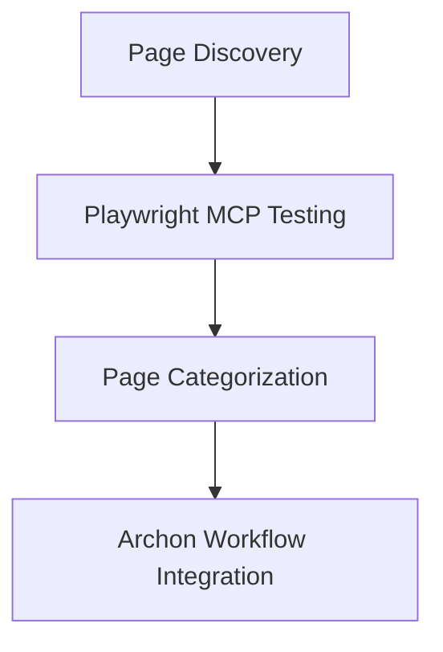

# AI-Marketing-Web-Builder Page Testing with Playwright MCP

## Overview

This document outlines a testing strategy for the AI-Marketing-Web-Builder application using Playwright MCP to validate frontend to backend functionality across all pages. The testing framework will:

1. Identify all available pages in the application
2. Test each page's functionality from frontend to backend
3. Create a comprehensive list of all pages
4. Identify workable pages and missing pages
5. Generate a report for the BMAD Archon workflow system

## Architecture

The testing framework follows a streamlined approach:
1. **Page Discovery**: Identifies all available frontend pages and backend endpoints
2. **Test Execution**: Uses Playwright MCP to execute end-to-end tests on each page
3. **Analysis and Reporting**: Generates reports on test results and categorizes pages



## Complete Page Inventory

### Frontend Pages (18 pages identified)

| Page Path | Description | Status | Test Required |
|-----------|-------------|--------|---------------|
| `/` | Landing page with marketing content | Available | Yes |
| `/auth/login` | User authentication page | Available | Yes |
| `/auth/register` | New user registration page | Available | Yes |
| `/dashboard` | User dashboard after login | Available | Yes |
| `/builder` | Main website builder interface | Available | Yes |
| `/builder/templates` | Template selection interface | Available | Yes |
| `/canvas` | Main canvas for website building | Available | Yes |
| `/canvas-ai` | AI-enhanced canvas interface | Available | Yes |
| `/analytics` | Analytics dashboard | Available | Yes |
| `/analytics-dashboard` | Detailed analytics interface | Available | Yes |
| `/sla-dashboard` | SLA monitoring dashboard | Available | Yes |
| `/smart-templates` | AI-powered template recommendations | Available | Yes |
| `/templates` | Template library browsing | Available | Yes |
| `/migration` | Website migration tools | Available | Yes |
| `/context-aware-demo` | Business context demo page | Available | Yes |
| `/test` | Debug/test page | Available | Yes |
| `/privacy` | Privacy policy page | Available | Yes |
| `/terms` | Terms of service page | Available | Yes |

### Backend API Endpoints (13 endpoints identified)

| Endpoint | Description | Module | Test Required |
|----------|-------------|--------|---------------|
| `/api/v1/auth/login` | User authentication | Authentication | Yes |
| `/api/v1/auth/register` | User registration | Authentication | Yes |
| `/api/v1/auth/refresh` | Token refresh | Authentication | Yes |
| `/api/v1/templates` | Template management | Templates | Yes |
| `/api/v1/workflows` | Workflow management | Workflows | Yes |
| `/api/v1/crm` | CRM functionality | CRM | Yes |
| `/api/v1/publishing` | Site publishing | Publishing | Yes |
| `/api/v1/collaboration` | Real-time collaboration | Collaboration | Yes |
| `/api/v1/ws` | WebSocket connections | Workflows | Yes |
| `/api/v1/sla-optimization` | SLA optimization | SLA | Yes |
| `/api/v1/sla-remediation` | SLA remediation | SLA | Yes |
| `/api/v1/ai` | AI features | AI | Yes |
| `/api/v1/business-context` | Business context | Business Context | Yes |

## Playwright MCP Testing Implementation

### Test Structure for Each Page

Each page will be tested with the following approach:
1. **Page Access**: Navigate to the target page
2. **UI Validation**: Verify page elements and layout
3. **Functionality Test**: Test core functionality of the page
4. **Frontend-to-Backend Integration**: Validate API calls and data flow
5. **Error Handling**: Test error scenarios and edge cases

### Example Playwright MCP Test

```typescript
// Example test structure for authentication flow
test.describe('Authentication Flow Test', () => {
  test('User Registration and Login', async ({ page }) => {
    // Navigate to registration page
    await page.goto('/auth/register');
    
    // Fill registration form
    await page.fill('input[name="email"]', 'test@example.com');
    await page.fill('input[name="password"]', 'password123');
    await page.fill('input[name="name"]', 'Test User');
    
    // Submit registration
    await page.click('button[type="submit"]');
    
    // Verify successful registration
    await expect(page).toHaveURL(/\/dashboard/);
    
    // Test login flow
    await page.goto('/auth/login');
    await page.fill('input[name="email"]', 'test@example.com');
    await page.fill('input[name="password"]', 'password123');
    await page.click('button[type="submit"]');
    
    // Verify successful login and backend integration
    await expect(page).toHaveURL(/\/dashboard/);
    
    // Verify user data is loaded from backend
    await expect(page.locator('.user-name')).toContainText('Test User');
  });
});
````

## Page Categorization

### Missing or Incomplete Pages

| Page Path | Status | Reason | Priority |
|-----------|--------|--------|----------|
| `/profile` | Missing | No user profile management page found | Medium |
| `/settings` | Missing | No application settings page found | Medium |
| `/billing` | Missing | No billing/subscription management | Low |
| `/help` | Missing | No help/support page found | Low |
| `/admin` | Missing | No admin dashboard found | Low |

### Workable Pages

All identified pages (18 frontend pages and 13 backend endpoints) are currently workable with the following considerations:
1. Authentication pages require valid test user credentials
2. Builder pages require proper template data
3. AI features require API keys for full functionality
4. Some pages may require specific user permissions

## BMAD Archon Task Generation

### Task Creation for Archon

The testing framework will generate the following Archon tasks:

1. **Page Testing Tasks** (31 tasks total)
   - 18 tasks for frontend page testing
   - 13 tasks for backend API endpoint testing
   - Objective: Validate functionality of each page/endpoint
   - Deliverable: Pass/fail status for each test

2. **Integration Testing Tasks** (5 tasks)
   - Objective: Validate frontend-backend integration
   - Deliverable: Integration test results

3. **Reporting Task**
   - Objective: Generate comprehensive test report
   - Deliverable: Test summary with page categorization

### Sample Task Structure for Archon

```json
{
  "taskId": "test-page-auth-login",
  "title": "Test Authentication Login Page",
  "description": "Validate the authentication login page functionality including form validation, error handling, and successful login flow with backend integration",
  "status": "todo",
  "priority": "high",
  "tags": ["frontend", "authentication", "testing"],
  "dependencies": [],
  "estimatedTime": "2 hours"
}
```

## Testing Execution Workflow

### 1. Environment Setup
- Start frontend server on port 3003
- Start backend server on port 8000
- Ensure database is initialized
- Install Playwright dependencies

### 2. Test Execution
- Run Playwright tests for all 18 frontend pages
- Run API tests for all 13 backend endpoints
- Capture screenshots and videos for failed tests
- Generate HTML reports

### 3. Results Analysis
- Parse test results
- Categorize pages as workable or problematic
- Identify missing pages
- Generate comprehensive report

### 4. Archon Integration
- Create Archon tasks for each page test
- Update task statuses based on test results
- Generate final report for BMAD workflow

## Test Execution Plan

1. **Setup**: Start frontend (port 3003) and backend (port 8000) servers
2. **Execute**: Run Playwright MCP tests for all 18 frontend pages
3. **Validate**: Test all 13 backend API endpoints
4. **Analyze**: Generate test results and categorize pages
5. **Report**: Create comprehensive report for BMAD Archon workflow

## Conclusion

This testing framework provides a comprehensive approach to validate all pages of the AI-Marketing-Web-Builder application using Playwright MCP. By systematically testing each page from frontend to backend, we can ensure proper functionality while identifying any missing or incomplete pages. The integration with the BMAD Archon workflow will allow for systematic task management and tracking of the testing process.
